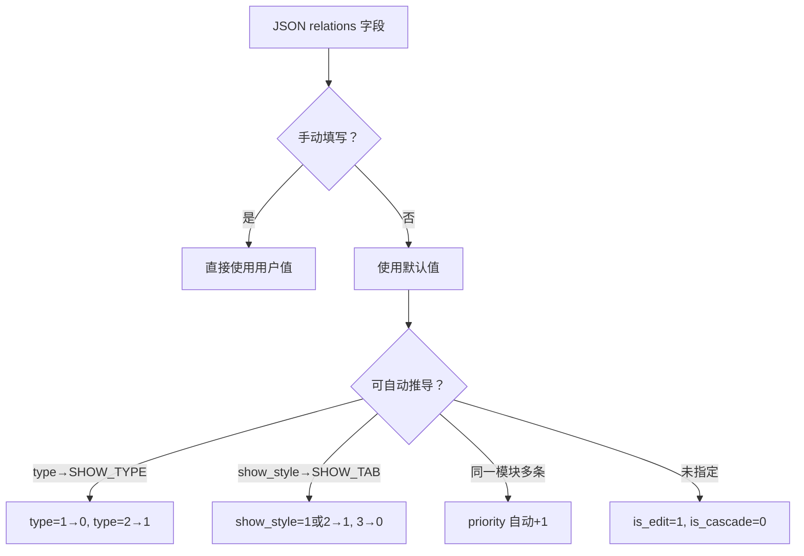

# 多表关联配置规则（md_module_link）

> **用途**: 定义模块之间的关联关系，生成 `md_module_link` INSERT SQL。
> **适用条件**: 模块定义 JSON 中包含 `relations` 数组。
> **前置要求**: 必须已阅读 `rules/BASIC-CRUD.md`，基础 CRUD 规则是本规则的前提。

---

## 1. 概述

`md_module_link` 是系统唯一的关联关系配置表，支持两种关联类型：
- **type=1**: 一对一（当前模块通过外键指向关联模块）
- **type=2**: 一对多（关联模块通过外键指向当前模块）

所有关联配置在模块定义 JSON 的 `relations` 数组中声明。

---

## 2. 核心规则

### 规则1：type 与 SHOW_TYPE 绑定

| type | 含义 | SHOW_TYPE | SHOW_TYPE 含义 |
|------|------|-----------|----------------|
| **1** | 一对一 | **0**（固定） | 内联表格 |
| **2** | 一对多 | **1**（固定） | 弹窗选择 |

> ⚡ **SHOW_TYPE 由 type 决定，不可独立配置。type=1→0, type=2→1。**

### 规则2：show_style 与 tab_name 绑定

| show_style | 含义 | tab_name 要求 |
|-----------|------|--------------|
| **1** | 平级TAB | **必填** — 填写 Tab 页名称 |
| **2** | 子TAB | **必填** — 填写子 Tab 页名称 |
| **3** | 按顺序展示 | 可选 — 无需 Tab 名称 |

### 规则3：edit_module 关联模式

| edit_module | 含义 | 适用场景 | 生成器行为 |
|------------|------|---------|-----------|
| **0** | 父子表 | 主从关系（如订单→订单明细） | 生成外键 INSERT + 子表列表页 |
| **1** | 中间表 | 多对多/间接关联（如用户↔角色） | 生成中间表 INSERT/DELETE |

### 规则4：非空字段

以下 **16 个字段不允许为空**：
```
module_id, related_module_id, field_name, field_id,
related_table, related_field, related_field_name,
type, is_edit, display_name, edit_module,
is_cascade, priority, SHOW_TAB, SHOW_TYPE, show_style
```

### 规则5：默认值

| 字段 | 默认值 | 说明 |
|------|--------|------|
| `is_cascade` | **0** | 默认不级联 |
| `is_edit` | **1** | 默认可编辑 |
| `SHOW_TAB` | **1** | 默认在 Tab 页展示 |
| `show_style` | **1** | 默认平级 TAB |
| `priority` | **1** | 默认优先级为 1，同一模型多条关联时自动 +1 |

---

## 3. JSON 定义示例

### 3.1 一对一关联 (type=1, edit_module=0)

```json
{
  "relations": [
    {
      "type": 1,
      "related_module": "customer",
      "field_name": "customer_id",
      "related_field_name": "name",
      "display_name": "客户名称",
      "edit_module": 0,
      "is_cascade": 0,
      "show_style": 1,
      "tab_name": "客户信息"
    }
  ]
}
```

**含义**: 当前模块的 `customer_id` 字段指向 `customer` 模块的主键，显示关联记录的 `name` 字段值。在平级TAB中展示。

### 3.2 一对多关联 (type=2, edit_module=0)

```json
{
  "relations": [
    {
      "type": 2,
      "related_module": "order_item",
      "related_field_name": "order_id",
      "display_name": "订单明细",
      "edit_module": 0,
      "is_cascade": 1,
      "show_style": 2,
      "tab_name": "明细"
    }
  ]
}
```

**含义**: `order_item` 模块中有 `order_id` 字段指向当前模块的主键。删除当前订单时级联删除明细。在子TAB中展示。

### 3.3 中间表关联 (type=1/2, edit_module=1)

```json
{
  "relations": [
    {
      "type": 2,
      "related_module": "role",
      "display_name": "订单角色",
      "edit_module": 1,
      "is_cascade": 0,
      "show_style": 1,
      "tab_name": "角色"
    }
  ]
}
```

**含义**: 通过中间表关联订单和角色（不直接存外键）。使用弹窗选择。在平级TAB中展示。

### 3.4 按顺序展示 (show_style=3)

```json
{
  "relations": [
    {
      "type": 1,
      "related_module": "customer",
      "field_name": "customer_id",
      "related_field_name": "name",
      "display_name": "所属客户",
      "edit_module": 0,
      "is_cascade": 0,
      "show_style": 3,
      "tab_name": null
    }
  ]
}
```

**含义**: 不带 Tab 标签，直接按顺序在页面中内嵌显示。

---

## 4. JSON → md_module_link 字段映射

### 🧭 核心概念：当前模型 vs 关联模型

`md_module_link` 描述两个模型之间的关联关系，所有字段分为两组：

| 归属 | 字段 | 含义 |
|------|------|------|
| **当前模型**（当前模块） | `field_name` / `field_id` | **我自己的哪个字段**指向了对方？ |
| **关联模型**（关联模块） | `related_field_name` / `related_field` | **对方的哪个字段**被我引用了？（用于前端展示和关联查询） |

> ❌ **常见错误**：Agent 把 `related_field` 和 `field_name` 混为一谈，导致配置错误。
> ✅ **正确理解**：`field_xxx` 描述的是**当前模型**的字段；`related_field_xxx` 描述的是**关联模型**的字段。

#### type=1 举例：product → category
```
当前模型(product)                        关联模型(category)
┌─────────────────┐                    ┌─────────────────┐
│ category_id     │ ──── 外键指向 ──→  │ id (主键)       │
│  (field_name)   │                    │                 │
│                 │                    │ name (显示字段) │
│ 其他字段...     │                    │  (related_field │
│                 │                    │   _name)        │
└─────────────────┘                    └─────────────────┘

field_name = "category_id"   ← 当前模块的外键字段名
field_id   = category_id 的 field ID

related_field      = category.id 的 field ID   ← 关联模块中被引用的字段
related_field_name = "name"                    ← 关联模块中用于前端显示的字段
```

#### type=2 举例：category → product
```
当前模型(category)                        关联模型(product)
┌──────────────────┐                   ┌──────────────────┐
│ id (主键)        │                   │ category_id      │ ← ─ 外键指向当前模块
│  (field_name)    │                   │ (related_field)  │
│                  │                   │                  │
│ 其他字段...      │                   │ product_name等   │
└──────────────────┘                   └──────────────────┘

field_name = "id"              ← 当前模块的主键（关联模块的外键指向它）
field_id   = id 的 field ID

related_field      = product.category_id 的 field ID   ← 关联模块中指向当前模块的外键
related_field_name = "category_id"                      ← 同一字段（外键名）
```

### 字段映射表

| JSON 属性 | md_module_link 字段 | 必填 | 规则/推导方式 |
|-----------|-------------------|------|-------------|
| `type` | type | ✅ | 1=一对一, 2=一对多 |
| `related_module` | → module_id, related_module_id | ✅ | 从 md_module 查 UUID 填充 |
| `field_name` | field_name | type=1✅, type=2❌ | **当前模型的外键字段名**。type=1 时必填（如 `category_id`），type=2 时填空字符串 |
| `related_field_name` | related_field_name | ✅ | **关联模型中的关联字段名**。type=1 时为显示字段（如 `name`），type=2 时为外键字段（如 `category_id`） |
| `display_name` | display_name | ✅ | 前端展示的中文名 |
| `edit_module` | edit_module | ✅ | 0=父子表, 1=中间表 |
| `is_cascade` | is_cascade | ✅ | 默认 0 |
| `show_style` | show_style | ✅ | 1=平级TAB, 2=子TAB, 3=按顺序 |
| `tab_name` | tab_name | show_style=1或2时✅ | 其他情况可 NULL |
| — | `field_id` | ✅ | **自动推导**：从当前模块的 fields 中找 field_name 对应字段的 md_field ID |
| — | `related_table` | ✅ | **自动推导**：从 related_module 的 md_module.db_table 获取 |
| — | `related_field` | ✅ | **自动推导**（按 type 区分）：type=1→关联模块的 **主键 id**，type=2→关联模块中 `related_field_name` 对应的外键字段 ID |
| — | `SHOW_TYPE` | ✅ | **自动推导**：type=1→0, type=2→1 |
| — | `SHOW_TAB` | ✅ | **自动推导**：show_style=1或2→1, show_style=3→0 |
| — | `priority` | ✅ | **自动推导**：从1开始，同一模块多条关联自动+1 |
| — | `is_edit` | ✅ | **自动推导**：默认为1 |

> ⚠️ **Agent 必读：`related_field` 自动推导规则（无需手动配置）**
> - 只需要在 JSON 中填写 `field_name`（当前模型外键）和 `related_field_name`（关联模型字段名）
> - `related_field`（关联模型中的字段 ID）由生成器自动推导：
>   - **type=1**：指向关联模型的**主键 `id`**（因为当前模型的外键指向关联模型的主键）
>   - **type=2**：指向关联模型中由 `related_field_name` 指定的外键字段（该外键指向当前模块）

### 推导优先级



---

## 5. 各规则组合下的生成行为

| type | edit_module | is_cascade | show_style | SHOW_TYPE | SHOW_TAB | 生成行为 |
|------|------------|-----------|-----------|-----------|---------|---------|
| 1 | 0 | 0 | 1 | 0 | 1 | JOIN + 平级TAB内联展示，不级联 |
| 1 | 0 | 1 | 1 | 0 | 1 | JOIN + 平级TAB，级联删除 |
| 1 | 1 | 0 | 1 | 0 | 1 | 中间表 JOIN + 平级TAB，不级联 |
| 2 | 0 | 0 | 2 | 1 | 1 | 子表弹窗 + 子TAB，不级联 |
| 2 | 0 | 1 | 2 | 1 | 1 | 子表弹窗 + 子TAB，级联删除子表 |
| 2 | 1 | 0 | 2 | 1 | 1 | 中间表弹窗 + 子TAB，不级联 |

> 共 type×edit_module×show_style = 2×2×3 = 12 种组合，上表仅列出常见 6 种。

---

## 6. relations 字段校验规则

| 校验 | 规则 | 错误信息 |
|------|------|---------|
| type | ∈ {1, 2} | "type 只能是 1(一对一) 或 2(一对多)" |
| edit_module | ∈ {0, 1} | "edit_module 只能是 0(父子表) 或 1(中间表)" |
| show_style | ∈ {1, 2, 3} | "show_style 只能是 1(平级TAB)、2(子TAB) 或 3(按顺序)" |
| tab_name | show_style=1或2时必填 | "show_style 为 1 或 2 时 tab_name 不能为空" |
| field_name | type=1 时必填 | "type=1 时 field_name 不能为空" |
| field_name 存在性 | type=1 的 field_name 必须在 fields 数组中 | "field_name 'xxx' 在 fields 中不存在" |
| related_module | 必填 | "related_module 不能为空" |
| related_field_name | 必填 | "related_field_name 不能为空" |
| display_name | 必填 | "display_name 不能为空" |

---

## 7. 生成的 SQL 说明

### SQL 模板

**type=1（一对一）+ edit_module=0（父子表）**：
```sql
INSERT INTO md_module_link (id, module_id, related_module_id, field_name, field_id,
    related_table, related_field, related_field_name, type, is_edit, display_name,
    edit_module, is_cascade, priority, SHOW_TAB, SHOW_TYPE, show_style, tab_name)
VALUES (@link_uuid, @module_id, @related_module_id,
    '${field_name}', @field_id_for_field_name,
    '${related_table}', @related_field_id, '${related_field_name}',
    1, 1, '${display_name}',
    ${edit_module}, ${is_cascade}, ${priority},
    ${SHOW_TAB}, 0, ${show_style},
    '${tab_name}');
```

**type=2（一对多）+ edit_module=0（父子表）**：
```sql
INSERT INTO md_module_link (id, module_id, related_module_id, field_name, field_id,
    related_table, related_field, related_field_name, type, is_edit, display_name,
    edit_module, is_cascade, priority, SHOW_TAB, SHOW_TYPE, show_style, tab_name)
VALUES (@link_uuid, @module_id, @related_module_id,
    '', '',
    '${related_table}', @related_field_id, '${related_field_name}',
    2, 1, '${display_name}',
    0, ${is_cascade}, ${priority},
    1, 1, ${show_style},
    '${tab_name}');
```

### 说明
- `field_name` / `field_id`: type=1 时填写（外键字段），type=2 时为空字符串
- `@link_uuid`: 由 Python `uuid.uuid4()` 预生成
- `related_field`: 关联模块中外键字段的 md_field.id（通过 `related_field_name` 查找）
- SQL 顺序：放在模块、字段、表单之后，资源之前

---

## 8. 执行顺序（⚠️ 两阶段执行）

### 核心原则

**md_module_link INSERT 不能放在单个模块的 create.sql 中执行。**
原因：执行时关联模块可能还不存在，子查询返回 NULL 导致关联数据异常。

### 正确执行流程

```
第一阶段：创建所有模块
├── mysql < category_create.sql      # 创建商品分类（无关联）
├── mysql < product_create.sql       # 创建商品（无关联）
└── mysql < order_create.sql         # 创建订单（无关联）

第二阶段：创建所有关联（模块全部存在后）
├── mysql < category_relation.sql    # category→product
├── mysql < product_relation.sql     # product→category
└── mysql < order_relation.sql       # order→order_item
```

### 为什么这样设计

关联 INSERT 使用子查询查找关联模块：
```sql
-- 当 order 的 relation.sql 执行时，order_item 模块已存在 → 子查询成功
(SELECT id FROM md_module WHERE code = 'order_item' AND flg_deleted = 0)
```

如果在单模块 create.sql 中包含关联：
```sql
-- category_create.sql 执行时，product 模块还不存在 → related_module_id = NULL
(SELECT id FROM md_module WHERE code = 'product' AND flg_deleted = 0)  -- NULL!
```

### 关联 SQL 文件位置

```
output/{module_code}/v1.0.0/
├── {module_code}_create.sql       # 第一阶段：模块创建
├── {module_code}_relation.sql     # 第二阶段：关联创建（存在时才生成）
├── {module_code}_cleanup.sql      # 清理（倒序删除）
└── manifest.json
```

> Agent 使用本技能时，应先生成所有模块的 SQL，再统一执行 relation.sql。

---

## 8. 注意事项

### type=1 的依赖关系
- `field_name` **必须**同时出现在当前模块的 `fields` 数组中
- 关联模块**必须先存在**（先创建关联模块，再创建当前模块）
- type=1 生成 `JOIN` 类型的查询 SQL

### type=2 一对多的"多"端字段处理
在 "多" 端模块（如 product）中，用于存储外键的字段（如 `category_id`）有特殊的表单处理方式：

| 处理方式 | 说明 |
|---------|------|
| **列表展示** | ❌ 不展示。`is_show_in_grid=0` |
| **编辑页展示** | ❌ 编辑页存在但 `edit_type="hidden"`，用户不可见 |
| **可编辑性** | ✅ `is_edit=1`，配合 `edit_type="hidden"` 表示模型配置工具可写入 |
| **表单配置** | ✅ `edit_type: "hidden"`（隐藏字段） |
| **字段长度** | ✅ 自动强制 `length=64`，与主键长度一致 |
| **数据库字段** | ✅ 字段保留在数据库中，作为外键存储关联关系 |
| **模型配置工具** | 会自动为 hidden 字段赋值，无需用户手动填写 |

**示例**：product 的 `category_id` 字段（自动推断，无需手动配置）：
```json
{
  "field_name": "category_id",
  "display_type": "varchar",
  "comment": "所属分类",
  "nullable": true,
  "length": 64
  // form 由规则引擎自动配置为 hidden
}
```

> ⚠️ 常见错误：将 `category_id` 配置为 `edit_type: "select"` 并绑定字典。这会导致用户既可以通过产品编辑页选择分类，又可以通过分类 TAB 页选择产品，造成数据冗余和界面混乱。

### edit_module=1（中间表）
- 不在当前模块存外键，通过中间表关联
- 同时需要生成中间表的 INSERT/DELETE（但当前生成器不创建中间表的 md_module 定义）
- 适用于多对多关系（如用户↔角色、标签↔文章）

### 跨模块 @variable 链接
- `@related_module_id` 指向关联模块的 `@module_id`
- `@field_id_for_field_name` 指向当前模块中对应字段的 `@field_id`
- `@related_field_id` 指向关联模块中对应字段的 `@field_id`
- SQL 必须按正确顺序拼接（关联模块的 module/field 先于 current 模块的 module_link）

---

## 9. 参考文档

| 文档 | 说明 |
|------|------|
| `rules/BASIC-CRUD.md` | 基础 CRUD 规则（前提） |
| `docs/analysis/modules/md_relation/relation.md` | md_module_link 表结构参考 |
| `docs/analysis/modules/md_module/module.md` | 模块表结构（查 db_table） |
| `docs/analysis/modules/md_field/field.md` | 字段表结构（查 field_id） |
| `docs/analysis/modules/er-diagram.md` | 模块间 ER 关系 |

---

*版本: v1.0 · 基于用户确认的 md_module_link 规则（2026-05-11）*
