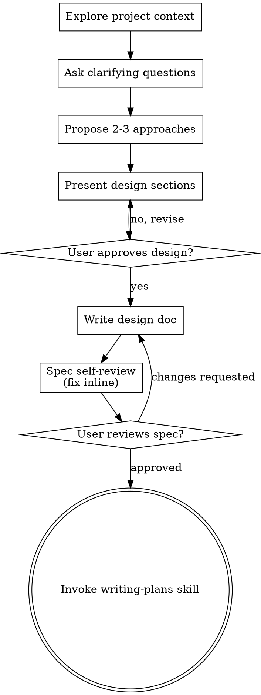

# Brainstorming Ideas Into Designs

Help turn ideas into fully formed designs and specs through natural collaborative dialogue.

Start by understanding the current project context, then ask questions one at a time to refine the idea. Once you understand what you're building, present the design and get user approval.

<HARD-GATE>
Do NOT invoke any implementation skill, write any code, scaffold any project, or take any implementation action until you have presented a design and the user has approved it. This applies to EVERY project regardless of perceived simplicity.
</HARD-GATE>

## Anti-Pattern: "This Is Too Simple To Need A Design"

Every project goes through this process. A todo list, a single-function utility, a config change — all of them. "Simple" projects are where unexamined assumptions cause the most wasted work. The design can be short (a few sentences for truly simple projects), but you MUST present it and get approval.

## Checklist

You MUST create a task for each of these items and complete them in order:

1. **Explore project context** — check files, docs, recent commits
2. **Offer the visual companion just-in-time** — NOT upfront. The first time a question would genuinely be clearer shown than described, offer it then (its own message); on approval its browser tab opens for you. If no visual question ever arises, never offer it. See the Visual Companion section below.
3. **Ask clarifying questions** — one at a time, understand purpose/constraints/success criteria
4. **Propose 2-3 approaches** — with trade-offs and your recommendation
5. **Present design** — in sections scaled to their complexity, get user approval after each section
6. **Write design doc** — save to `docs/superpowers/specs/YYYY-MM-DD-<topic>-design.md` and commit
7. **Spec self-review** — quick inline check for placeholders, contradictions, ambiguity, scope (see below)
8. **User reviews written spec** — ask user to review the spec file before proceeding
9. **Transition to implementation** — invoke writing-plans skill to create implementation plan

## Process Flow

**The terminal state is invoking writing-plans.** Do NOT invoke frontend-design, mcp-builder, or any other implementation skill. The ONLY skill you invoke after brainstorming is writing-plans.

## The Process

**Understanding the idea:**

- Check out the current project state first (files, docs, recent commits)
- Before asking detailed questions, assess scope: if the request describes multiple independent subsystems (e.g., "build a platform with chat, file storage, billing, and analytics"), flag this immediately. Don't spend questions refining details of a project that needs to be decomposed first.
- If the project is too large for a single spec, help the user decompose into sub-projects: what are the independent pieces, how do they relate, what order should they be built? Then brainstorm the first sub-project through the normal design flow. Each sub-project gets its own spec → plan → implementation cycle.
- For appropriately-scoped projects, ask questions one at a time to refine the idea
- Prefer multiple choice questions when possible, but open-ended is fine too
- Only one question per message - if a topic needs more exploration, break it into multiple questions
- Focus on understanding: purpose, constraints, success criteria

**Exploring approaches:**

- Propose 2-3 different approaches with trade-offs
- Present options conversationally with your recommendation and reasoning
- Lead with your recommended option and explain why

**Presenting the design:**

- Once you believe you understand what you're building, present the design
- Scale each section to its complexity: a few sentences if straightforward, up to 200-300 words if nuanced
- Ask after each section whether it looks right so far
- Cover: architecture, components, data flow, error handling, testing
- Be ready to go back and clarify if something doesn't make sense

**Design for isolation and clarity:**

- Break the system into smaller units that each have one clear purpose, communicate through well-defined interfaces, and can be understood and tested independently
- For each unit, you should be able to answer: what does it do, how do you use it, and what does it depend on?
- Can someone understand what a unit does without reading its internals? Can you change the internals without breaking consumers? If not, the boundaries need work.
- Smaller, well-bounded units are also easier for you to work with - you reason better about code you can hold in context at once, and your edits are more reliable when files are focused. When a file grows large, that's often a signal that it's doing too much.

**Working in existing codebases:**

- Explore the current structure before proposing changes. Follow existing patterns.
- Where existing code has problems that affect the work (e.g., a file that's grown too large, unclear boundaries, tangled responsibilities), include targeted improvements as part of the design - the way a good developer improves code they're working in.
- Don't propose unrelated refactoring. Stay focused on what serves the current goal.

## After the Design

**Documentation:**

- Write the validated design (spec) to `docs/superpowers/specs/YYYY-MM-DD-<topic>-design.md`
  - (User preferences for spec location override this default)
- Use elements-of-style:writing-clearly-and-concisely skill if available
- Commit the design document to git

**Spec Self-Review:**
After writing the spec document, look at it with fresh eyes:

1. **Placeholder scan:** Any "TBD", "TODO", incomplete sections, or vague requirements? Fix them.
2. **Internal consistency:** Do any sections contradict each other? Does the architecture match the feature descriptions?
3. **Scope check:** Is this focused enough for a single implementation plan, or does it need decomposition?
4. **Ambiguity check:** Could any requirement be interpreted two different ways? If so, pick one and make it explicit.

Fix any issues inline. No need to re-review — just fix and move on.

**User Review Gate:**
After the spec review loop passes, ask the user to review the written spec before proceeding:

> "Spec written and committed to `<path>`. Please review it and let me know if you want to make any changes before we start writing out the implementation plan."

Wait for the user's response. If they request changes, make them and re-run the spec review loop. Only proceed once the user approves.

**Implementation:**

- Invoke the writing-plans skill to create a detailed implementation plan
- Do NOT invoke any other skill. writing-plans is the next step.

## Key Principles

- **One question at a time** - Don't overwhelm with multiple questions
- **Multiple choice preferred** - Easier to answer than open-ended when possible
- **YAGNI ruthlessly** - Remove unnecessary features from all designs
- **Explore alternatives** - Always propose 2-3 approaches before settling
- **Incremental validation** - Present design, get approval before moving on
- **Be flexible** - Go back and clarify when something doesn't make sense

## Visual Companion

A browser-based companion for showing mockups, diagrams, and visual options during brainstorming. Available as a tool — not a mode. Accepting the companion means it's available for questions that benefit from visual treatment; it does NOT mean every question goes through the browser.

**Offering the companion (just-in-time):** Do NOT offer it upfront. Wait until a question would genuinely be clearer shown than told — a real mockup / layout / diagram question, not merely a UI *topic*. The first time that happens, offer it then, as its own message:
> "This next part might be easier if I show you — I can put together mockups, diagrams, and comparisons in a browser tab as we go. It's still new and can be token-intensive. Want me to? I'll open it for you."

**This offer MUST be its own message.** Only the offer — no clarifying question, summary, or other content. Wait for the user's response. If they accept, start the server with `--open` so their browser opens to the first screen automatically. If they decline, continue text-only and don't offer again unless they raise it.

**Per-question decision:** Even after the user accepts, decide FOR EACH QUESTION whether to use the browser or the terminal. The test: **would the user understand this better by seeing it than reading it?**

- **Use the browser** for content that IS visual — mockups, wireframes, layout comparisons, architecture diagrams, side-by-side visual designs
- **Use the terminal** for content that is text — requirements questions, conceptual choices, tradeoff lists, A/B/C/D text options, scope decisions

A question about a UI topic is not automatically a visual question. "What does personality mean in this context?" is a conceptual question — use the terminal. "Which wizard layout works better?" is a visual question — use the browser.

If they agree to the companion, read the detailed guide before proceeding:
`skills/brainstorming/visual-companion.md`

## Badou Enterprise Addendum

## 何时建议用生成器

**生成器适用于任意基础 CRUD 模块**（员工、订单、商品、客户、字典维护、流程审批等），不限于某类业务。当用户用以下话术描述需求时，**主动建议**走生成器：

- "做个XX管理" / "加个XX模块" / "做个XX维护"
- "管理后台加个XX"
- "CRUD" / "增删改查"
- "类似商品那种" / "和XX一样的"

## 何时不要用

- **UI 微调**：只改现有模块的样式、文案、字段顺序 → 直接改前端
- **纯 bug 修复**：现有模块的 bug → 不走生成器
- **非 MD 系统**：CAS 单点登录、移动 uniapp、定时任务 → 各自独立的工具/技能
- **数据迁移**：从老库搬数据到新库 → 写迁移脚本

## 场景路由（拆分后）

brainstorming 时**先问用户**属于哪种场景：

1. **纯 CRUD（单表或多表）**：仅业务模块 -> 用 `backend-module-generator`；
   读 `rules/BASIC-CRUD.md`（有关联则加读 `rules/MODULE-LINK.md`）。
2. **纯流程（无业务模块）**：仅审批/工作流 -> 用 `backend-flow-engine`；
   读其 `rules/FLOW-ENGINE.md`；产出 `flow.json`。
3. **CRUD + 流程**：**先**用 `backend-flow-engine` 创建 `flw_flow`，
   **再**用 `backend-module-generator` 设 `module.flow_code` 生成模块。
   读 `rules/FLOW-CONTRACT.md` 了解集成契约。
4. **生成后定制**：在标准 CRUD 之上叠加 -> `badou-md-customization-skill`
   （YAGNI，暂未建；仅记录边界）。
5. **更新现有模块**：在已有 MD 模块基础上做增量更新（增/删/改字段、字典、按钮、基础配置、流程绑定、关联关系、资源权限）→ 用 `backend-module-updater`；
   读其 `SKILL.md` 了解与 generator 的边界；参考 `update_rules/` 下 13 种更新方式的规则说明。

**不要替用户决定** - 流程场景影响 `flow_code` 设置与字段冲突。

## 产出：module.json 草稿

头脑风暴结束时产出 `module.json` 草稿（或待用户确认的字段清单）。草稿包含：

- `module.code` / `module.name_cn` / `module.db_table`
- `fields` 数组（每个字段：`field_name` / `display_type` / `comment` / `length` / `nullable`）
- `dictionaries` 数组（哪些字段用下拉）
- 若含流程：`module.flow_code` + `module.flow_business_name_field`

让用户 review 后再交给 `writing-plans`。

## 交接

字段清单 + 场景确定后，**不要在 brainstorming 阶段**直接写 JSON 或跑生成器——交给 `writing-plans`。理由：生成步骤要进计划文档（含重跑验证、定制阶段），不是头脑风暴的产出。

## JSON 字段类型映射

业务概念 → JSON 字段类型的常用映射：

| 业务概念 | display_type | 备注 |
|---|---|---|
| 名称 / 标题 / 编码 | `varchar` | `length: 100` |
| 描述 / 备注 / 长文本 | `text` | 无 length |
| 整数（数量、年龄） | `int` | |
| 金额 / 比率 | `decimal` | 配 `length: 18, scale: 2` |
| 日期（不含时间） | `date` | |
| 时间戳 | `datetime` | |
| 布尔（是否） | `tinyint` | `length: 1` |
| 隐藏字段 | `hidden` | 用于创建人/创建时间等系统字段 |
| 只读字段 | `readonly` | 用于外部系统回填字段 |

## 不要做

- **不**自己写 SQL 文件（生成器干这事）
- **不**为"快"绕过生成器手写表结构（下次重跑会被覆盖）
- **不**在字段里加 `approval_status` / `audit_status` / `status`——`flow_code` 非空时由生成器自动注入 `BO_STATUS`，自己定义会冲突
- **不**替用户决定"是否含流程"——业务判断应由用户确认

## 与 superpowers 的差异

superpowers `brainstorming` 产出"功能 spec + 用户故事"；我们的 brainstorming 额外产出"module.json 字段草稿"（CN 字段名 + 类型 + 长度），让后续 `writing-plans` 直接能用。

---

## Output location override

本项目 spec 输出**不要**用上游默认路径 `docs/superpowers/specs/`，**统一写到 workspace 根目录 `docs/badoucoding/specs/`**（plain folder，不入 git；跨团队参考用）。

- 跨栈 spec → workspace 根 `docs/badoucoding/specs/`
- 单一栈 spec → workspace 根 `docs/badoucoding/specs/`（也写到根，不再分仓）

`.claude/docs/` 仅存前后端业务/通用说明文档（如 `frontend-standard.md`、`icon-usage-guide.md`），**不**放 spec/plan。

## Cross-stack automation awareness

当工作目录是 `badou-workspace/` 且同时存在 `backend/`、`frontend/`、`.claude/` 三个子目录时（即本设计的目标布局），在原有 5 场景路由之后**追加 Q5**：

> Q5: 这个模块是否需要前端 customSetting？
> - 不需要 → 走标准 CRUD + 流程生成
> - 需要 list 页定制 → 调用 `frontend-module-list`
> - 需要 edit 页定制 → 调用 `frontend-module-edit`
> - 需要 tree 类定制 → 调用 `frontend-module-tree-{edit,list,table}`
> - 需要字段扩展 → 调用 `frontend-module-extend-field`

**输出物扩展**（跨栈场景下）：
- `module.json`（已有）
- `flow.json`（如含流程，已有）
- `contracts/<mdCode>/backend-api.yaml`（**新增**）
- `contracts/<mdCode>/frontend-js.yaml`（**新增**，如需前端定制）

**触发条件**：`pwd` 含 `backend/` `frontend/` `.claude/` 三个 sibling 目录。在单仓（如 `initial-project/`）运行时不触发。
