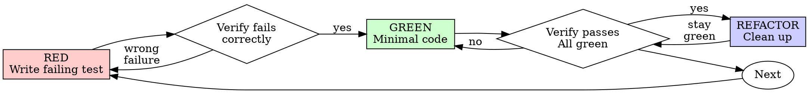

# Test-Driven Development (TDD)

## Overview

Write the test first. Watch it fail. Write minimal code to pass.

**Core principle:** If you didn't watch the test fail, you don't know if it tests the right thing.

**Violating the letter of the rules is violating the spirit of the rules.**

## When to Use

**Always:**
- New features
- Bug fixes
- Refactoring
- Behavior changes

**Exceptions (ask your human partner):**
- Throwaway prototypes
- Generated code
- Configuration files

Thinking "skip TDD just this once"? Stop. That's rationalization.

## The Iron Law

```
NO PRODUCTION CODE WITHOUT A FAILING TEST FIRST
```

Write code before the test? Delete it. Start over.

**No exceptions:**
- Don't keep it as "reference"
- Don't "adapt" it while writing tests
- Don't look at it
- Delete means delete

Implement fresh from tests. Period.

## Red-Green-Refactor



### RED - Write Failing Test

Write one minimal test showing what should happen.

<Good>
```typescript
test('retries failed operations 3 times', async () => {
  let attempts = 0;
  const operation = () => {
    attempts++;
    if (attempts < 3) throw new Error('fail');
    return 'success';
  };

  const result = await retryOperation(operation);

  expect(result).toBe('success');
  expect(attempts).toBe(3);
});
```
Clear name, tests real behavior, one thing
</Good>

<Bad>
```typescript
test('retry works', async () => {
  const mock = jest.fn()
    .mockRejectedValueOnce(new Error())
    .mockRejectedValueOnce(new Error())
    .mockResolvedValueOnce('success');
  await retryOperation(mock);
  expect(mock).toHaveBeenCalledTimes(3);
});
```
Vague name, tests mock not code
</Bad>

**Requirements:**
- One behavior
- Clear name
- Real code (no mocks unless unavoidable)

### Verify RED - Watch It Fail

**MANDATORY. Never skip.**

```bash
npm test path/to/test.test.ts
```

Confirm:
- Test fails (not errors)
- Failure message is expected
- Fails because feature missing (not typos)

**Test passes?** You're testing existing behavior. Fix test.

**Test errors?** Fix error, re-run until it fails correctly.

### GREEN - Minimal Code

Write simplest code to pass the test.

<Good>
```typescript
async function retryOperation<T>(fn: () => Promise<T>): Promise<T> {
  for (let i = 0; i < 3; i++) {
    try {
      return await fn();
    } catch (e) {
      if (i === 2) throw e;
    }
  }
  throw new Error('unreachable');
}
```
Just enough to pass
</Good>

<Bad>
```typescript
async function retryOperation<T>(
  fn: () => Promise<T>,
  options?: {
    maxRetries?: number;
    backoff?: 'linear' | 'exponential';
    onRetry?: (attempt: number) => void;
  }
): Promise<T> {
  // YAGNI
}
```
Over-engineered
</Bad>

Don't add features, refactor other code, or "improve" beyond the test.

### Verify GREEN - Watch It Pass

**MANDATORY.**

```bash
npm test path/to/test.test.ts
```

Confirm:
- Test passes
- Other tests still pass
- Output pristine (no errors, warnings)

**Test fails?** Fix code, not test.

**Other tests fail?** Fix now.

### REFACTOR - Clean Up

After green only:
- Remove duplication
- Improve names
- Extract helpers

Keep tests green. Don't add behavior.

### Repeat

Next failing test for next feature.

## Good Tests

| Quality | Good | Bad |
|---------|------|-----|
| **Minimal** | One thing. "and" in name? Split it. | `test('validates email and domain and whitespace')` |
| **Clear** | Name describes behavior | `test('test1')` |
| **Shows intent** | Demonstrates desired API | Obscures what code should do |

## Why Order Matters

**"I'll write tests after to verify it works"**

Tests written after code pass immediately. Passing immediately proves nothing:
- Might test wrong thing
- Might test implementation, not behavior
- Might miss edge cases you forgot
- You never saw it catch the bug

Test-first forces you to see the test fail, proving it actually tests something.

**"I already manually tested all the edge cases"**

Manual testing is ad-hoc. You think you tested everything but:
- No record of what you tested
- Can't re-run when code changes
- Easy to forget cases under pressure
- "It worked when I tried it" ≠ comprehensive

Automated tests are systematic. They run the same way every time.

**"Deleting X hours of work is wasteful"**

Sunk cost fallacy. The time is already gone. Your choice now:
- Delete and rewrite with TDD (X more hours, high confidence)
- Keep it and add tests after (30 min, low confidence, likely bugs)

The "waste" is keeping code you can't trust. Working code without real tests is technical debt.

**"TDD is dogmatic, being pragmatic means adapting"**

TDD IS pragmatic:
- Finds bugs before commit (faster than debugging after)
- Prevents regressions (tests catch breaks immediately)
- Documents behavior (tests show how to use code)
- Enables refactoring (change freely, tests catch breaks)

"Pragmatic" shortcuts = debugging in production = slower.

**"Tests after achieve the same goals - it's spirit not ritual"**

No. Tests-after answer "What does this do?" Tests-first answer "What should this do?"

Tests-after are biased by your implementation. You test what you built, not what's required. You verify remembered edge cases, not discovered ones.

Tests-first force edge case discovery before implementing. Tests-after verify you remembered everything (you didn't).

30 minutes of tests after ≠ TDD. You get coverage, lose proof tests work.

## Common Rationalizations

| Excuse | Reality |
|--------|---------|
| "Too simple to test" | Simple code breaks. Test takes 30 seconds. |
| "I'll test after" | Tests passing immediately prove nothing. |
| "Tests after achieve same goals" | Tests-after = "what does this do?" Tests-first = "what should this do?" |
| "Already manually tested" | Ad-hoc ≠ systematic. No record, can't re-run. |
| "Deleting X hours is wasteful" | Sunk cost fallacy. Keeping unverified code is technical debt. |
| "Keep as reference, write tests first" | You'll adapt it. That's testing after. Delete means delete. |
| "Need to explore first" | Fine. Throw away exploration, start with TDD. |
| "Test hard = design unclear" | Listen to test. Hard to test = hard to use. |
| "TDD will slow me down" | TDD faster than debugging. Pragmatic = test-first. |
| "Manual test faster" | Manual doesn't prove edge cases. You'll re-test every change. |
| "Existing code has no tests" | You're improving it. Add tests for existing code. |

## Red Flags - STOP and Start Over

- Code before test
- Test after implementation
- Test passes immediately
- Can't explain why test failed
- Tests added "later"
- Rationalizing "just this once"
- "I already manually tested it"
- "Tests after achieve the same purpose"
- "It's about spirit not ritual"
- "Keep as reference" or "adapt existing code"
- "Already spent X hours, deleting is wasteful"
- "TDD is dogmatic, I'm being pragmatic"
- "This is different because..."

**All of these mean: Delete code. Start over with TDD.**

## Example: Bug Fix

**Bug:** Empty email accepted

**RED**
```typescript
test('rejects empty email', async () => {
  const result = await submitForm({ email: '' });
  expect(result.error).toBe('Email required');
});
```

**Verify RED**
```bash
$ npm test
FAIL: expected 'Email required', got undefined
```

**GREEN**
```typescript
function submitForm(data: FormData) {
  if (!data.email?.trim()) {
    return { error: 'Email required' };
  }
  // ...
}
```

**Verify GREEN**
```bash
$ npm test
PASS
```

**REFACTOR**
Extract validation for multiple fields if needed.

## Verification Checklist

Before marking work complete:

- [ ] Every new function/method has a test
- [ ] Watched each test fail before implementing
- [ ] Each test failed for expected reason (feature missing, not typo)
- [ ] Wrote minimal code to pass each test
- [ ] All tests pass
- [ ] Output pristine (no errors, warnings)
- [ ] Tests use real code (mocks only if unavoidable)
- [ ] Edge cases and errors covered

Can't check all boxes? You skipped TDD. Start over.

## When Stuck

| Problem | Solution |
|---------|----------|
| Don't know how to test | Write wished-for API. Write assertion first. Ask your human partner. |
| Test too complicated | Design too complicated. Simplify interface. |
| Must mock everything | Code too coupled. Use dependency injection. |
| Test setup huge | Extract helpers. Still complex? Simplify design. |

## Debugging Integration

Bug found? Write failing test reproducing it. Follow TDD cycle. Test proves fix and prevents regression.

Never fix bugs without a test.

## Testing Anti-Patterns

When adding mocks or test utilities, read [testing-anti-patterns.md](testing-anti-patterns.md) to avoid common pitfalls:
- Testing mock behavior instead of real behavior
- Adding test-only methods to production classes
- Mocking without understanding dependencies

## Final Rule

```
Production code → test exists and failed first
Otherwise → not TDD
```

No exceptions without your human partner's permission.

## Badou Enterprise Addendum

## 工具栈（必读）

本项目（八斗框架 / Spring Boot 1.8 / Java 1.8）历史包袱决定了 TDD 工具栈：

- **JUnit 4.12**（**不是 5.x**）。框架自带的 `BaseHibernateDAOTest`、`JpaTemplateTest` 用了 4 的 `org.junit.Before/@Test` + `org.junit.runner.RunWith`，迁到 5 会破坏既有测试基类
- **Mockito 1.10.19**（**不是 2.x / 3.x**）。`1.10.19` 是 Java 1.8 + Spring 时代的最后一版，框架的 `bdPlugin-message` 测试桩代码硬编码用了 1.x 的 `Matchers` / `verifyZeroInteractions`
- **Spring Test 4.x**（不是 5.x）— 随 Spring Boot 1.8 自带，不要手升
- **AssertJ 1.x 可选** — 如果项目里有就用，没有就别强加

## 测试基类（按层选）

| 测试对象 | 必须继承 | 原因 |
|---|---|---|
| DAO 单测 | `com.badou.brms.base.test.BaseHibernateDAOTest` | 自动注入 Spring context + 事务回滚 + 字段填充 |
| Service 单测 | `com.badou.brms.base.test.BaseSpringServiceTest` | 同上，自动 mock 同包下的 DAO |
| Struts Action 单测 | `com.badou.brms.base.test.BaseStrutsActionTest` | 处理 Struts2 的 `ActionContext` 初始化 |
| Controller/Rest 单测 | 自行用 `MockMvc` + `@RunWith(SpringJUnit4ClassRunner.class)` | 框架没给基类 |
| 纯工具类 | 普通 JUnit 4 + Mockito 1.10.19 | — |

**严禁**直接 `new` 出 DAO/Service 实体绕开 Spring — 框架的 `@Autowired` 字段填充（创建人/创建时间等）依赖 Spring 上下文。

## 命名与目录

- 测试类名：`FooServiceTest` 对应 `IFooService`；`FooDAOTest` 对应 `IFooDAO`
- 测试方法名：`shouldXxxWhenYyy` 风格（**不是** `testXxx`），便于 IDE 折叠 + 报告分组
- 目录镜像：`src/main/java/com/badou/project/foo/dao/IFooDAO.java`
  → `src/test/java/com/badou/project/foo/dao/FooDAOTest.java`
- 一个测试方法只断言一个业务场景；多个场景拆多个 `@Test`

## 注释与 Javadoc

- 测试方法上的 Javadoc **必须中文**，描述"业务场景"而不是"代码做了什么"
- 中文标点用全角（，。、）；代码标识符内用半角
- 复杂测试数据用 `// given / when / then` 三段注释（**不是**空行分隔）

## 数据与状态

- 单元测试不依赖数据库时：把 `applicationContext-test.xml` 里的 datasource 切到 H2 in-memory
- 需要真库：使用 `init_framework` 库（开发环境），**不**用生产库 `init`
- 清理策略：测试结束 `@After` 调 `BaseHibernateDAOTest#truncateAll()`，不依赖 Spring 事务回滚（Flyway 场景下回滚不可靠）
- 字典/枚举数据用 `comm_dictionary` fixture；不要硬编码业务 ID

## Coverage & CI

- **最低 80% 行覆盖**（与 `~/.claude/rules/common/testing.md` 对齐）
- `pom.xml` 的 `maven-surefire-plugin` 配置了 `<skip>true</skip>`，`mvn package` 不会跑测试
- 显式跑：`mvn test` 或 `mvn surefire:test`
- CI 必跑：`mvn checkstyle:check && mvn test -Dmaven.test.failure.ignore=false`
- 覆盖率报告：`mvn jacoco:report`（如果配了 JaCoCo 插件）

## 不要做

- **不要**写"实现完再补测试"的提交；TDD 红绿重构顺序硬性
- **不要**用 PowerMock 模拟 static / final（Mockito 1.10 本身支持；硬要 PowerMock 是设计问题，回去重构）
- **不要**测私有方法（应通过 public API 间接覆盖）
- **不要**在测试里 `Thread.sleep`（用 Awaitility 0.x 替代）
- **不要**用 `@Ignore` / `@Disabled` 跳过失败的测试（修代码，不要修测试）
- **不要**把测试基类的 `truncateAll()` 注释掉"省时间"——会让下一个开发者怀疑整个测试套件的可信度

## 与 superpowers 原始规则的差异

- superpowers:test-driven-development 强调"RED-GREEN-REFACTOR"循环——**沿用**
- superpowers 建议每行实现都有测试——**沿用，但放宽到 80% 覆盖**（框架历史包袱，部分 setter/getter 自动生成不值得测）
- superpowers 建议 mock 一切依赖——**仅限 Service/Controller 层**；DAO 层用真库 H2/in-memory（mock 掉 JDBC 测不出 SQL bug）

## 测生成 vs 测定制

本项目用 `backend-module-generator` 生成基础 CRUD 后做定制。测试分工如下：

**测（定制代码）**：
- 自定义 service 方法
- 自定义 validators
- 自定义 controller（含特殊 URL / 参数）
- 跨表业务逻辑

**不测（生成器产物）**：
- 生成的 `md_module` / `md_field` / `md_form` 记录 → `idempotent_check.py` 覆盖
- 生成的 `sys_resource` / `sys_role_resource` → 同上
- 生成的 DDL / 建表 SQL → 同上
- 业务表的 CRUD 通用接口（用生成器生成的 `BaseSpringService` 默认实现）→ 没必要逐行测

## 不要测生成实体

- **不**为 `FooEntity`（生成器自动生成的 JPA 实体）写单测——它由生成器保证
- **不**为生成器生成的 `getXxx()` / `setXxx()` 写单测——setter/getter 行为不需要测试
- **不**测试 `md_module` 是否在数据库里——那是 `idempotent_check.py` 的工作
- **不**测试 `comm_dictionary` 字典数据正确性——同上

如果发现"必须测生成代码"才正确，多半是 JSON 定义错了（回 `brainstorming` / `writing-plans` 检查字段定义）。
