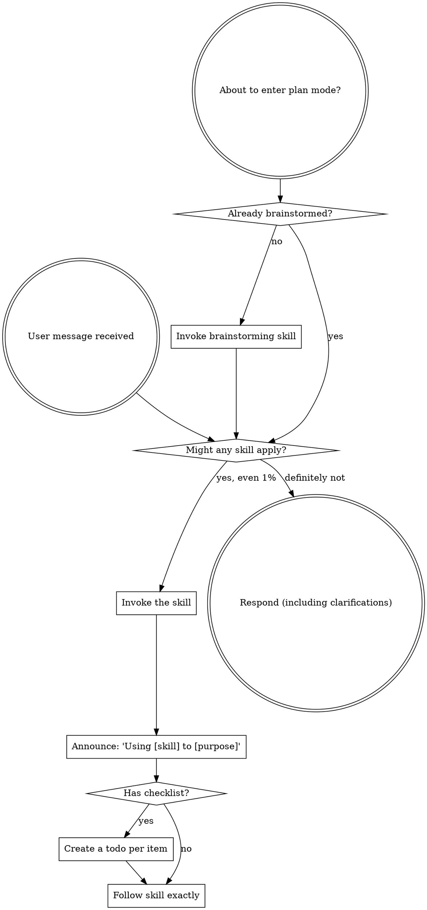

<!-- badou-coding managed: this skill may have a `.badou-local.en.md` companion containing Badou enterprise rules in English; its content is auto-injected at the BADOU-LOCAL-ANCHOR below. The source file `.badou-local.md` (in any language, typically Chinese) is the human-editable original; ask Claude to translate it to `.badou-local.en.md`. To add or modify enterprise rules, edit `.badou-local.md` (or `.badou-local.en.md` directly in English), then re-run `python3 .claude/badou-coding-sync.py`. -->

<SUBAGENT-STOP>
If you were dispatched as a subagent to execute a specific task, skip this skill.
</SUBAGENT-STOP>

<EXTREMELY-IMPORTANT>
If you think there is even a 1% chance a skill might apply to what you are doing, you ABSOLUTELY MUST invoke the skill.

IF A SKILL APPLIES TO YOUR TASK, YOU DO NOT HAVE A CHOICE. YOU MUST USE IT.

This is not negotiable. This is not optional. You cannot rationalize your way out of this.
</EXTREMELY-IMPORTANT>

## Instruction Priority

Superpowers skills override default system prompt behavior, but **user instructions always take precedence**:

1. **User's explicit instructions** (CLAUDE.md, GEMINI.md, AGENTS.md, direct requests) — highest priority
2. **Superpowers skills** — override default system behavior where they conflict
3. **Default system prompt** — lowest priority

If CLAUDE.md, GEMINI.md, or AGENTS.md says "don't use TDD" and a skill says "always use TDD," follow the user's instructions. The user is in control.

## How to Access Skills

**Never read skill files manually with file tools** — always use your platform's skill-loading mechanism so the skill is properly activated.

**In Claude Code:** Use the `Skill` tool. When you invoke a skill, its content is loaded and presented to you — follow it directly.

**In Codex:** Skills load natively. Follow the instructions presented when a skill activates.

**In Copilot CLI:** Use the `skill` tool. Skills are auto-discovered from installed plugins.

**In Gemini CLI:** Skills activate via the `activate_skill` tool. Gemini loads skill metadata at session start and activates the full content on demand.

**In other environments:** Check your platform's documentation for how skills are loaded.

## Platform Adaptation

Skills speak in actions ("dispatch a subagent", "create a todo", "read a file") rather than naming any one runtime's tools. For per-platform tool equivalents and instructions-file conventions, see [claude-code-tools.md](references/claude-code-tools.md), [codex-tools.md](references/codex-tools.md), [copilot-tools.md](references/copilot-tools.md), [gemini-tools.md](references/gemini-tools.md), [pi-tools.md](references/pi-tools.md), and [antigravity-tools.md](references/antigravity-tools.md). Gemini CLI users get the tool mapping loaded automatically via GEMINI.md.

# Using Skills

## The Rule

**Invoke relevant or requested skills BEFORE any response or action.** Even a 1% chance a skill might apply means that you should invoke the skill to check. If an invoked skill turns out to be wrong for the situation, you don't need to use it.



## Red Flags

These thoughts mean STOP—you're rationalizing:

| Thought | Reality |
|---------|---------|
| "This is just a simple question" | Questions are tasks. Check for skills. |
| "I need more context first" | Skill check comes BEFORE clarifying questions. |
| "Let me explore the codebase first" | Skills tell you HOW to explore. Check first. |
| "I can check git/files quickly" | Files lack conversation context. Check for skills. |
| "Let me gather information first" | Skills tell you HOW to gather information. |
| "This doesn't need a formal skill" | If a skill exists, use it. |
| "I remember this skill" | Skills evolve. Read current version. |
| "This doesn't count as a task" | Action = task. Check for skills. |
| "The skill is overkill" | Simple things become complex. Use it. |
| "I'll just do this one thing first" | Check BEFORE doing anything. |
| "This feels productive" | Undisciplined action wastes time. Skills prevent this. |
| "I know what that means" | Knowing the concept ≠ using the skill. Invoke it. |

## Skill Priority

When multiple skills could apply, use this order:

1. **Process skills first** (brainstorming, systematic-debugging) - these determine HOW to approach the task
2. **Implementation skills second** (frontend-design, mcp-builder) - these guide execution

"Let's build X" → brainstorming first, then implementation skills.
"Fix this bug" → systematic-debugging first, then domain-specific skills.

## Skill Types

**Rigid** (TDD, systematic-debugging): Follow exactly. Don't adapt away discipline.

**Flexible** (patterns): Adapt principles to context.

The skill itself tells you which.

## User Instructions

Instructions say WHAT, not HOW. "Add X" or "Fix Y" doesn't mean skip workflows.

<!-- BADOU-LOCAL-ANCHOR: do not remove this comment, badou-coding-sync.py relies on it -->

## Badou Enterprise Addendum

## What the platform is

`backend-module-generator` is the **foundation skill of the
internal low-code development platform**. It generates MD module SQL
(`md_module` / `md_field` / `md_form` / `sys_resource` /
`comm_dictionary`, etc.) from a JSON definition; every subsequent
feature starts from this generated model data and adds custom
development on top.

**Scope**: any basic CRUD module (employees, orders, products,
customers, dictionary maintenance, workflow approvals, etc.) — not
limited to any single business domain.

Three categories of consumer skills will plug in later (page-rendering
customization, business-interface customization, extension-point
customization); they all consume the model data produced by this
generator.

## Model data schema

The generator outputs 8 categories of tables / records. Downstream
consumer skills (future) read these:

| Table | Stores |
|---|---|
| `md_module` | Module basics (code, name, table name) |
| `md_field` | Field definitions (type, length, required, dictionary) |
| `md_form` | Form configuration (editor type, validation, display rules) |
| `md_button` | Button configuration (6 standard buttons: Create / View / Edit / Delete / Import / Export) |
| `sys_resource` | Menu / button resources (permission granularity) |
| `sys_role_resource` | Role authorization (which role may use which menu) |
| `comm_dictionary` + `comm_dictionary_item` | Data dictionary (source for dropdown options) |

If `module.flow_code` is non-empty, the generator **automatically
injects** 7 extra workflow fields (`FLOW_ID` / `FLOW_NAME` /
`FLOW_INSTANCE_ID` / `NODE_INSTANCE_ID` / `NODE_INSTANCE_NAME` /
`BO_STATUS` / `NODE_CODE`) into the business table plus a
`BO_STATUS` dictionary (Draft / Approving / Approved / Rejected).

## Three-step workflow

Every CRUD module development must go through these 3 steps; skipping
any one of them is not acceptable:

```bash
# Step 1: Generate SQL
python3 .claude/skills/backend-module-generator/crud_generator.py \
    --def <project>/crud-generator/module_defs/<module>.json \
    --output <project>/crud-generator/output/

# Step 2: Execute SQL (must use db_executor.py, NOT the mysql CLI)
python3 .claude/skills/backend-module-generator/db_executor.py \
    <project>/crud-generator/output/<module>/v<version>/<module>_create.sql \
    --config-from-brain <project>/.trellis/PROJECT-BRAIN.md

# Step 3: Idempotency check (ALL PASSED is required to count as done)
python3 .claude/skills/backend-module-generator/validators/idempotent_check.py \
    <project>/crud-generator/module_defs/<module>.json
# → exit code 0 + output "ALL PASSED ✅" to pass
```

**Skipping any step = not done.** See the `verification-before-completion`
skill for details.

## Three scenarios

Read the generator's built-in rules documentation for the details:

| Scenario | What to read |
|---|---|
| Single-table CRUD (no relations, no flow) | `rules/BASIC-CRUD.md` |
| Multi-table relations (with `md_module_link`) | `rules/MODULE-LINK.md` |
| Flow engine (`module.flow_code` non-empty) | `rules/FLOW-ENGINE.md` |

**Flow engine + CRUD combined** (most complex): split into two JSON
files (`flow.json` + `module.json`), run `--flow-only` first, then run
`--def`.

## Multi-project isolation

- **DB configuration**: always read from
  `<project>/.trellis/PROJECT-BRAIN.md`; never hard-code connections.
- **Output path**: `<project>/crud-generator/output/<module>/v<version>/`,
  already in `.gitignore`.
- **Cross-project forbidden**: do not run project A's `module.json`
  against project B's database.
- **Multi-collaborator**: simultaneous edits to `PROJECT-BRAIN.md`
  conflict; `git pull` before editing.

## CLI flag quick reference

| Flag | Purpose |
|---|---|
| `--def <json>` | Specify module definition JSON |
| `--output <dir>` | Specify output directory (default `./output`) |
| `--dry-run` | Preview SQL only, do not write files |
| `--validate` | Validate JSON syntax only, do not generate |
| `--config-from-brain <path>` | Read DB configuration from PROJECT-BRAIN.md |
| `--flow-only <flow.json>` | Generate the 7 flow-engine tables only, not the module |
| `--flow-execute` | Combine with `--flow-only`; execute directly to DB |
| `--flow-clean` | Combine with `--flow-only`; clean only, do not create |

## Do not

- **Do not** hand-edit SQL under `crud-generator/output/` — editing
  bypasses the generator; the next run will overwrite your changes.
- **Do not** skip `idempotent_check.py` — it checks 8 categories of
  issues including the dictionary three-conditions and flow-field
  conflicts; skipping it will cause production bugs.
- **Do not** run multiple `crud_generator.py --def` instances in
  parallel against the same DB — MySQL user-variable conflicts
  corrupt data (see the `dispatching-parallel-agents` skill).
- **Do not** use the wrong project's `PROJECT-BRAIN.md` — it will
  pollute another database.

## Cross-references

- Trigger words and JSON field mapping for brainstorming new modules
  → `brainstorming` skill
- Three-step workflow for plan generation → `writing-plans` skill
- Testing generator output + customization code → `test-driven-development` skill
- Hard threshold for running `idempotent_check.py`
  → `verification-before-completion` skill
- Common failure patterns when SQL generation fails
  → `systematic-debugging` skill
- User-variable conflicts from parallel generation
  → `dispatching-parallel-agents` skill

